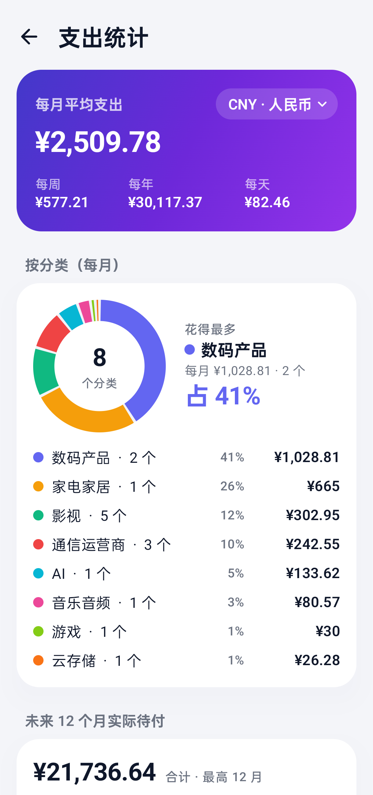
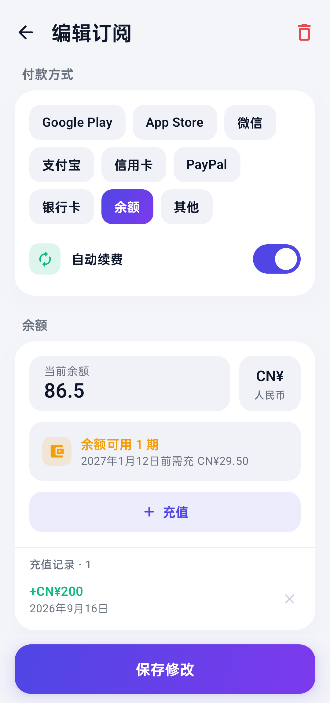
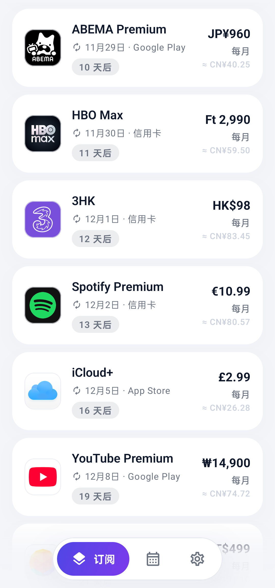
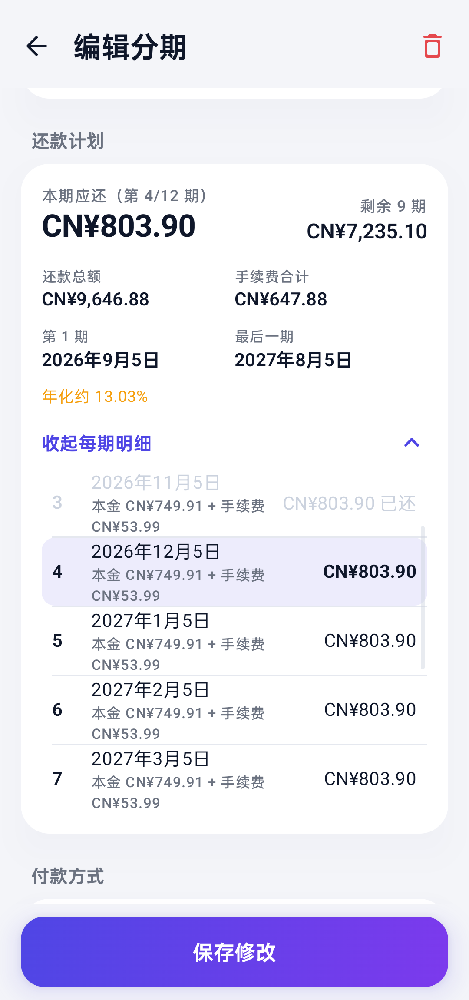
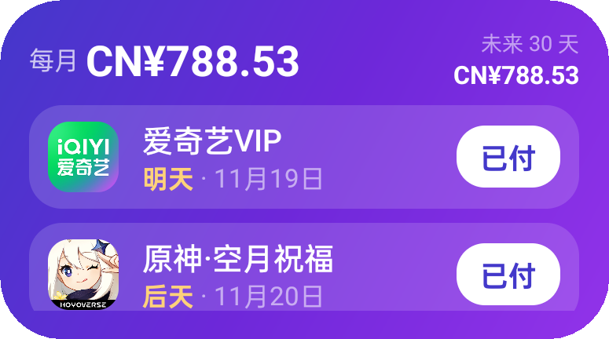
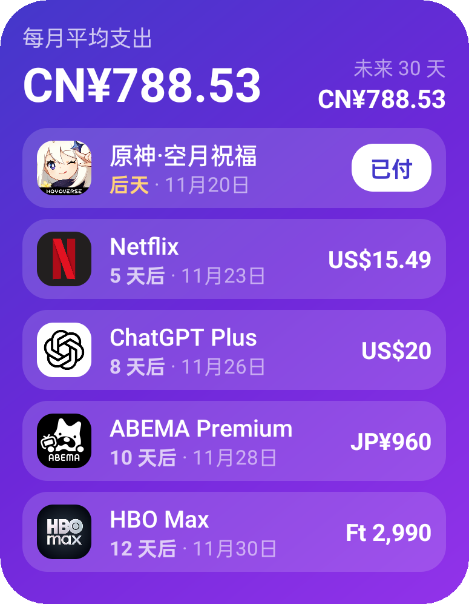

# Subnook（icefirercom 个人定制版）

> **上游项目与协议声明**：本项目基于 [capllen/Subnook](https://github.com/capllen/Subnook) 进行个人非商业定制修改，遵循原项目 [PolyForm Noncommercial 1.0.0](LICENSE) 许可证。
>
> `Required Notice: Copyright (c) 2026 capllen (https://github.com/capllen/Subnook)`

Subnook 是一个简洁的 Android 订阅和分期管理 App：记录各种会员 / 订阅 / 非周期到期项 / 定期账单和分期付款，自动滚动扣款日期，到期前提醒，并按周 / 月 / 年统计花费。数据保存在本机，也可以备份到你自己的 WebDAV。

### 个人定制改动
- **非周期订阅与提醒优先**：新增「非周期订阅」类型（选到期时间与扣款方式，金额可选，到期确认后自动归档）；到期提醒在首页待付款区、小组件及系统通知栏均优先排在周期订阅之前。
- **中文习惯日期选择器**：自研纯中文日历弹窗（周一起始、左右滑切月、点击年月网格快选、内置「今天 / 1个月后 / 3个月后 / 半年后 / 1年后」快捷定位）。
- **支付平台 + 全局复用扣款渠道池**：一级选支付平台（Google Pay、微信、支付宝等），二级选实际扣款账户（如 `信用卡7727`、`借记卡2990`、`微信零钱`），跨平台复用，统计页支持按扣款渠道汇总每月扣款总额。
- **设置内可视化管理**：支持在设置中新增、编辑及开关启停「扣款方式」「实际扣款渠道」和「内置 / 自定义订阅源」。
- **暖纸墨绿 · 极简账本风 UI**：整体重做浅色（宣纸米白 + 深松石墨绿 + 暖琥珀）与深色（深松烟夜色 + 玉石青绿）视觉体系、卡片描边与桌面小组件配色。

<p>
  
  
  
</p>

<p>
  
  
  
</p>

## 功能

- **订阅记录**：名称、图标、金额、币种、周期（每 N 天 / 周 / 月 / 年）、下次付款日期、付款方式（Google Play、App Store、微信、支付宝、信用卡、PayPal、银行卡、余额等）、分类、备注；付款方式和分类选「其他」时可以自己命名，并加入预设
- **自动 / 手动续费**：自动续费的订阅过了账单日自动记账并滚动到下一期；关掉自动续费就是手动付款，需点「我已付款」才更新。3 天内到期的都会进入「待付款」，可以提前确认（应对 Google 等提前扣款）
- **分期付款**：填写本金、期数、计息方式（免息 / 每期手续费 / 首期收手续费 / 等额本息 / 等额本金）、费率和当前期数，自动算出每期金额和还款计划；支持花呗、京东白条、微信分付、信用卡等付款方式；可以提前还款（一次还清 / 减少每期还款 / 缩短期数），删除记录即可撤销
- **余额付款**：记录预付余额，自动预测还能付几期、哪天前要充值，扣款时从余额扣除，余额不足会提醒
- **提醒**：默认账单日前 3 天开始每天提醒一次（提前天数 0–30 天可调），手动付款逾期每天提醒，通知上可直接点「已付款」
- **排序**：按下次付款日期、月均金额、名称、分类、添加时间排序，可选正序 / 倒序；也可以长按卡片拖动手动排序
- **统计**：首页按周 / 月 / 年显示平均支出（订阅和分期合计）；详细统计页有分类环形图、花费排行、未来 12 个月待付、订阅 / 分期占比、按付款方式 / 币种分布、已付款记录
- **多币种**：31 种常用货币，显示币种可切换，汇率每 24 小时自动更新（[open.er-api.com](https://open.er-api.com)）
- **账单日历**：每天显示当天扣款的订阅图标，过去显示实际付款记录
- **250+ 预设**：国内外常用软件、游戏、云服务、VPN、通信运营商等，自带图标和参考价格；也可以从相册选图（可裁剪）或用内置设计图标
- **备份**：导出 / 导入 JSON（含付款记录、充值记录、自定义图标和设置）；也可以备份到 WebDAV（坚果云、Nextcloud、群晖等），支持每天自动备份。只有设置了 WebDAV 才会联网上传，账号密码只保存在本机
- **桌面小组件**：不用打开 App 就能看到每月支出和即将扣款的订阅 / 分期，列表可上下滑动
<p>
  
  
</p>

## 下载

到 [Releases](../../releases) 下载 APK（Android 8.0 及以上）。

## 编译

技术栈：Kotlin、Jetpack Compose（Material 3）、Room、DataStore、WorkManager、Glance、OkHttp（WebDAV）。需要 JDK 17+ 和 Android SDK（compileSdk 36）。

**用 Android Studio**：直接打开 `Subnook/` 目录。

**命令行**：

```bash
cd Subnook
./gradlew assembleDebug      # 输出 app/build/outputs/apk/debug/
./gradlew testDebugUnitTest  # 单元测试
```

**Release 签名**：把 `Subnook/keystore.properties.example` 复制为 `keystore.properties` 并填入自己的签名信息；没有这个文件时 release 包使用 debug 签名。

**Windows 便携工具链（可选）**：`scripts/env.ps1` / `scripts/env.sh` 会把 JDK、SDK、Gradle 及其缓存、临时文件都指向仓库内的 `toolchain/` 目录（不在 git 里，需要自己放入 `jdk21/`、`sdk/`、`gradle-8.14.3/`），`scripts/build.ps1`、`scripts/install.ps1` 用来编译和通过 adb 安装。

## 预设与图标

- 预设列表在 `Subnook/tools/presets.psv`（名称、分类、品牌色、参考价、币种、周期、默认付款方式、图标来源）
- 修改后在 `Subnook/` 下运行（Git Bash / Linux / macOS）：
  - `bash tools/fetch_icons.sh`：下载新增预设的图标（来源顺序：Google Play → App Store → 网站 favicon），`--force` 全部重新下载
  - `bash tools/gen_presets.sh`：重新生成 `PresetCatalog.kt`
  - `java tools/IconSheet.java sheet.png [key...]`：把图标拼成一张总览图，方便核对

欢迎通过 PR 补充预设。

## 小提示

- 一些国产系统（如 ColorOS）后台管控较严，建议在 App 设置里开启「准时提醒」和「忽略电池优化」，并在系统设置中允许自启动。
- ColorOS 不支持 App 内一键添加小组件：请长按桌面空白处 → 卡片 → 插件 → Subnook。

## 声明

预设中的应用图标和名称是其各自所有者的商标，仅用于帮助用户识别订阅，本项目与这些公司没有任何关联。如果你是权利人并希望移除，请提 issue。

## 许可证

[PolyForm Noncommercial 1.0.0](LICENSE)：可以免费用于个人、学习、研究等**非商业用途**，也可以 fork、修改和分发（需保留许可证和版权声明），但**禁止任何商业用途**。如需商用，请先通过 issue 联系作者。
