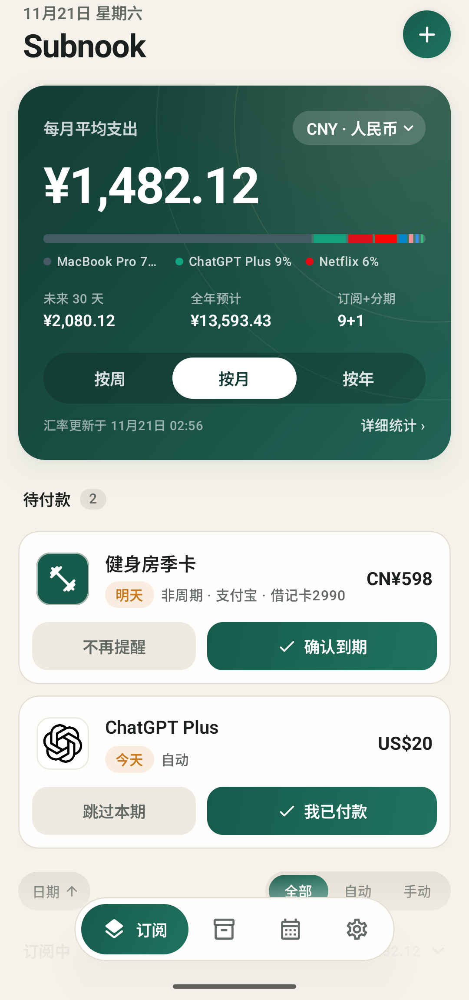
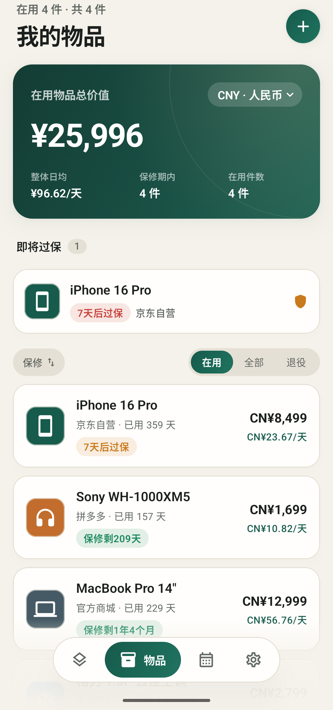
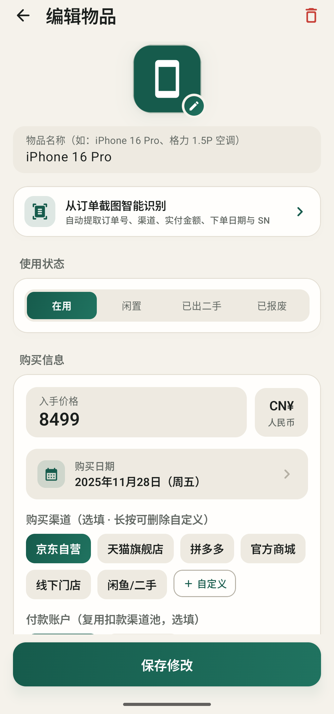
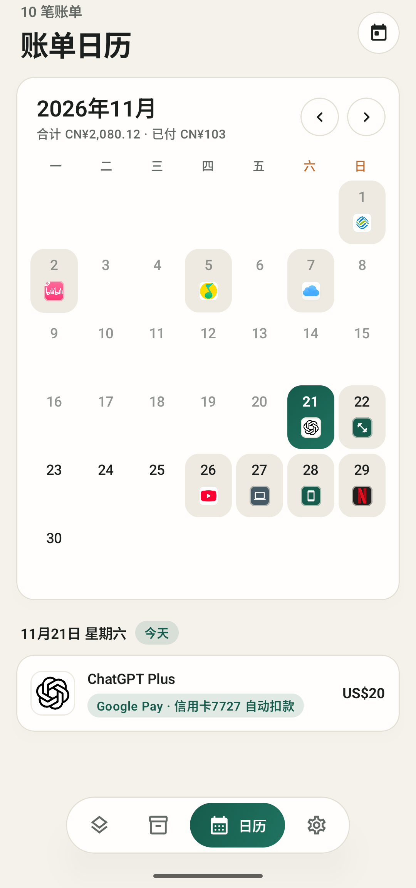
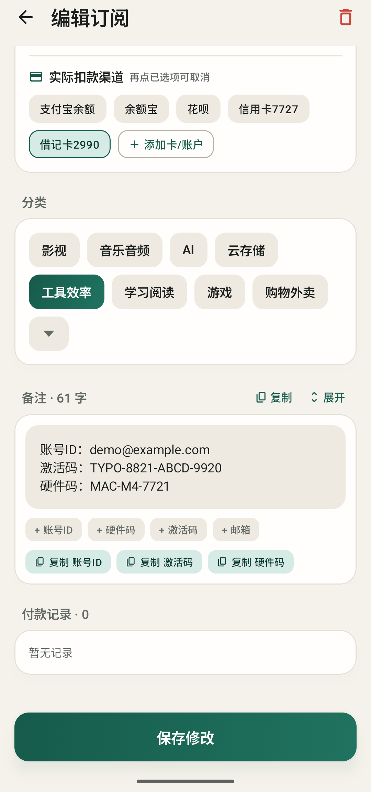

# Subnook（icefirercom 个人定制版）

> **上游项目与协议声明**：本项目基于 [capllen/Subnook](https://github.com/capllen/Subnook) 进行个人非商业定制修改，遵循原项目 [PolyForm Noncommercial 1.0.0](LICENSE) 许可证。
>
> `Required Notice: Copyright (c) 2026 capllen (https://github.com/capllen/Subnook)`

Subnook 是一个简洁的 Android **个人订阅、分期与实物保修管理 App**：在一个本地优先的账本里统一管理周期会员、非周期/买断软件、分期还款，以及手机/家电等实物资产与保修期。数据默认全部保存在本机，支持 JSON 备份、本地回退快照与自有 WebDAV 云端同步。

## 界面预览

<p align="center">
  
  
  
</p>

<p align="center">
  
  
  
</p>

> 示意图依次展示：**首页待付款与月均总览** → **实物资产与保修追踪** → **订单截图离线 OCR 识别** → **账单与保修日历** → **多维度支出统计** → **实际扣款渠道与可扩展备注**。

## 个人定制亮点

- **实物资产与保修管理（「物品」独立 Tab）**：
  - 独立数据库表存放手机、电脑、空调等大件物品档案，**不污染每月订阅支出统计**；自动计算持有天数、实际净支出（支持标记闲置、已出二手回血与报废）与日均使用成本。
  - 支持整机保修快捷推算（6 个月 / 1 年 / 2 年 / 3 年 / 6 年 / 10 年 / 自定义）及附加核心部件延保（如空调压缩机 10 年、AppleCare+），按关键节点提醒（默认提前 30 天 / 7 天 / 当天），并同步呈现在账单日历中。
  - 内置序列号 SN / 订单号一键复制，支持附加最多 3 张发票 / 保修卡 / 实物凭证照片（自动压缩存档并随备份同步），还可一键为物品创建周期保养 / 耗材提醒。
- **线上订单截图离线智能识别（OCR）**：
  - 基于本机内置 ML Kit 中文识别模型，**全程纯本地离线解析，不联网、不上传隐私截图**（国内无 GMS 机型可直接使用）。
  - 支持京东、淘宝 / 天猫、拼多多、Apple Store、官方商城、抖音商城、闲鱼及电子发票截图，自动提取 **订单号**（多单号可点选切换）、**购买渠道**、**实付金额**、**下单日期**（回填后自动联动重算保修到期日）及 **SN / IMEI**，并可勾选同步存为凭证照片。
- **非周期订阅与「无结束时间（买断制）」**：
  - 新增「非周期订阅」类型（选到期时间与扣款方式，金额可选，到期确认后自动归档）；到期提醒在首页待付款区、小组件及系统通知栏均**优先排在周期订阅之前**。
  - 支持开启 **「无结束时间（买断制）」** 开关，用于记录一次性买断软件或永久会员，标注「永久有效 / 买断」，不触发到期倒计时、待付款与提醒。
- **可扩展备注与一键复制胶囊**：
  - 订阅与物品编辑页备注框支持一键在紧凑（3–8 行）与大框（8–20 行）间切换，提供常用字段快捷插入（`账号ID` / `硬件码` / `激活码` / `邮箱` / `型号规格` / `维修记录`）。
  - 自动识别备注里的 `键：值` 行，生成单行一键复制胶囊，方便随时提取账号 ID、硬件码或激活码。
- **双层扣款渠道 + 中文习惯日期选择器**：
  - 一级选支付平台（Google Pay、微信、支付宝等），二级选全局复用的实际扣款账户（如 `信用卡7727`、`借记卡2990`、`微信零钱`），统计页支持跨平台按实际扣款渠道汇总；设置页支持可视化增删与启停扣款方式、扣款渠道及订阅源。
  - 自研纯中文、周一起始的日历选择弹窗，内置年月网格快选与快捷日期定位。
- **暖纸墨绿 · 极简账本风 UI**：
  - 重构浅色（宣纸米白 `#F5F2EB` + 深松石墨绿 `#165B4C` + 琥珀赤陶 `#C26D2D`）与深色（松烟夜 `#101412` + 玉石青绿 `#6BC4AD`）配色体系、卡片细节与桌面小组件。
- **本地回退快照与安全发版**：
  - 导入备份、云端恢复及版本升级前自动留存本地回退快照（保留近 8 份，支持秒级回退）；关于页支持查看 GitHub Releases 历史版本。

## 基础核心能力

- **订阅与续费管理**：支持自定义周期（每 N 天 / 周 / 月 / 年）、自动 / 手动续费、3 天内提前确认付款、提前 0–30 天到期提醒、多维排序与长按拖拽排序。
- **分期付款与提前还款**：支持免息、每期手续费、首期收手续费、等额本息、等额本金 5 种计息方式，自动生成分期计划并支持部分 / 一次性提前还款及撤销。
- **预付余额扣款**：适用于话费、点券、平台余额等，自动预测剩余可付期数与下次充值日。
- **多币种与统计**：内置 31 种货币与 24 小时自动汇率更新（[open.er-api.com](https://open.er-api.com)）；详细统计页包含分类环形图、花费排行、未来 12 个月待付预测、扣款渠道 / 币种占比与历史付款记录。
- **260+ 预设与桌面小组件**：覆盖国内外常用会员、云服务、游戏与运营商预设，支持相册裁剪图标与可滑动的 4×2 / 4×4 桌面小组件。
- **本地优先备份**：支持 JSON 导入导出与 WebDAV（坚果云、Nextcloud、群晖等）自动备份，不接入任何第三方账号或统计 SDK。

## 下载安装

前往 [Releases](../../releases) 下载最新正式签名的 `Subnook-vX.Y.Z.apk`（Android 8.0 及以上）。

> **提示**：由于内置了本机离线中文 OCR 模型（无需联网下载模型），Release APK 体积约 50 MB，安装后可完全离线识别订单截图。

## 开发、构建与发布

技术栈：Kotlin、Jetpack Compose（Material 3）、Room（含 Schema 导出）、DataStore、WorkManager、Glance、OkHttp（WebDAV）、ML Kit Chinese Text Recognition（离线 OCR）。需要 **JDK 21** 与 Android SDK（`compileSdk 36`）。

**Android Studio**：直接打开 `Subnook/` 目录即可编译。

**命令行 / Windows 工程脚本**（自动处理中文路径下的单测兼容与环境配置）：

```powershell
.\scripts\dev.ps1             # 运行全量单元测试 + 编译 Debug APK + 热装到已连接设备
.\scripts\release.ps1 -Tag    # 校验版本号/CHANGELOG/正式签名 + 单测 + 编 Release APK + apksigner 防呆验签 + 打 Tag
.\scripts\rollback.ps1 -List  # 查看历史标签并安全回退（创建回退分支或 revert 提交）
```

或直接使用 Gradle（macOS / Linux / Git Bash）：

```bash
cd Subnook
./gradlew testDebugUnitTest   # JVM 单元测试
./gradlew assembleDebug       # 输出 app/build/outputs/apk/debug/
```

**自动化 CI 与发版**：
- 推送 `main` 分支自动触发 [ci.yml](.github/workflows/ci.yml) 执行单元测试与 Debug 构建。
- 配置仓库 Actions Secrets（`KEYSTORE_BASE64`、`KEYSTORE_PASSWORD`、`KEY_ALIAS`、`KEY_PASSWORD`）后，执行 `git push origin main --follow-tags` 推送 `v*` 标签即可由 [release.yml](.github/workflows/release.yml) 自动完成单测、正式签名编译、防 Debug 签名验签与 GitHub Release 发布。

## 小提示

- 一些国产系统（如 ColorOS、HyperOS）后台管控较严，建议在 App 设置中开启「准时提醒」和「忽略电池优化」，并在系统设置中允许自启动。
- 若系统不支持 App 内一键添加小组件，请长按桌面空白处 → 插件 / 卡片 → Subnook。

## 声明

预设中的应用图标和名称是其各自所有者的商标，仅用于帮助用户识别订阅，本项目与这些公司没有任何关联。如果你是权利人并希望移除，请提 issue。

## 许可证

[PolyForm Noncommercial 1.0.0](LICENSE)：可以免费用于个人、学习、研究等**非商业用途**，也可以 fork、修改和分发（需保留许可证和版权声明），但**禁止任何商业用途**。如需商用，请先通过 issue 联系原项目作者。
